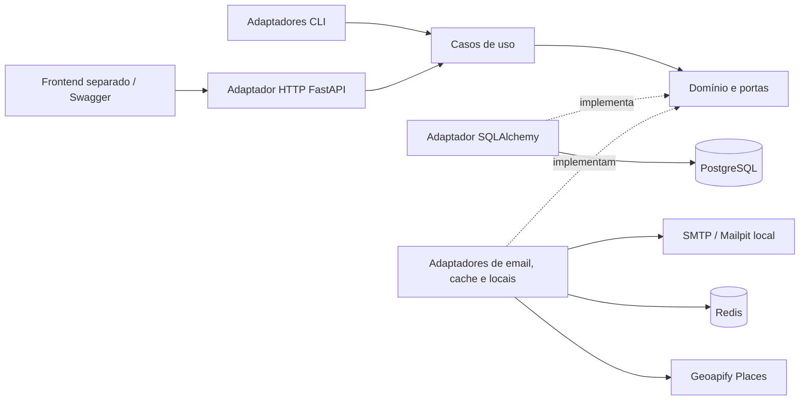
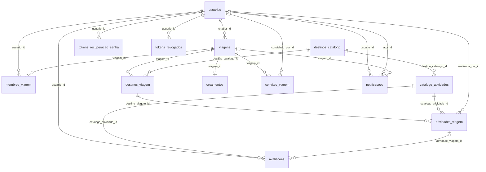

# Arquitetura do ViajaJunto — backend

Este documento descreve a implementação atual. A proposta inicial de 25/08/2026,
por Gustavo de Freitas Fidélis e Bernardo Lykawka Medeiros da Silva, previa um
backend NestJS. O backend deste repositório usa Python e FastAPI; os
[requisitos originais](requirements-ViajaJunto.md) permanecem como referência do
produto. As adaptações estão em [decisões de produto](decisoes-de-produto.md).

## Componentes e dependências

As setas para o núcleo representam dependências de código. Em execução, os casos
de uso recebem implementações das portas pela composição de dependências.
As regras obrigatórias estão em [ARQUITETURA_HEXAGONAL.md](../ARQUITETURA_HEXAGONAL.md).

| Local | Responsabilidade |
| --- | --- |
| `app/domain/` | Entidades, enums, invariantes, erros e interfaces das portas; sem FastAPI ou SQLAlchemy |
| `app/application/` | Casos de uso, permissões, coordenação de repositórios e transações |
| `app/adapters/inbound/` | Rotas, schemas HTTP, autenticação da requisição e comandos operacionais |
| `app/adapters/outbound/` | Persistência SQLAlchemy e implementações de segurança, email, cache e consulta de locais |
| `app/infrastructure/` | Configuração, banco e composição das implementações |
| `app/main.py` | Montagem da aplicação FastAPI |
| `alembic/` | Histórico versionado de migrações |

O frontend consome HTTP/JSON e renderiza mapas a partir de coordenadas e da ordem
das paradas. Este backend não renderiza mapas nem implementa uma interface web.
A integração Geoapify abastece o catálogo por comando operacional, sem tornar
cada consulta pública dependente do fornecedor. Fotos são URLs opcionais;
não existe armazenamento de arquivos ou bucket S3 implementado.

## Fluxo de uma operação

1. O adaptador HTTP valida o formato e resolve o usuário autenticado pelo JWT.
2. O caso de uso consulta os vínculos atuais e aplica as regras do domínio.
3. Os adaptadores executam as consultas e gravações dentro da transação.
4. A resposta é convertida para o contrato HTTP; erros de negócio são traduzidos
   para os códigos documentados no OpenAPI.

Criador, Editor e Visualizador são permissões por viagem. IDs não concedem
acesso. O catálogo é público; roteiros, orçamento e notificações dependem de
autorização. JWTs usam versão de sessão e revogação para invalidar acessos.
Convites e recuperação de senha persistem hashes dos tokens, com validade e uso único.
Consulte [permissões e políticas](decisoes-de-produto.md) para os detalhes.

## Modelo relacional

O catálogo representa locais reutilizáveis. `destinos_viagem` representa uma
parada do roteiro, enquanto `atividades_viagem` representa uma ocorrência agendada
de uma atividade do catálogo. Avaliações pertencem à atividade do catálogo e
podem manter a referência à ocorrência que comprovou sua realização.

O diagrama mostra chaves estrangeiras, inclusive as opcionais. `seeds_demonstracao`
é uma tabela operacional independente, sem relacionamentos.

| Tabela | Dados principais |
| --- | --- |
| `usuarios` | Nome, email único, hash de senha, versão de sessão e criação |
| `viagens` | Criador, nome, descrição, datas, status, moeda e timestamps |
| `membros_viagem` | Usuário, viagem, papel e entrada; um vínculo por par usuário/viagem |
| `destinos_catalogo` | Nome, país ISO, categoria, descrição, coordenadas, fuso, foto e origem externa |
| `destinos_viagem` | Viagem, destino de catálogo, ordem, chegada, saída, hospedagem e observações |
| `catalogo_atividades` | Destino de catálogo, nome, descrição, tipo, endereço, coordenadas, foto e origem externa |
| `atividades_viagem` | Parada, atividade de catálogo, data, horário, duração, custo previsto, status e realização |
| `orcamentos` | Viagem única, limite total opcional e atualização |
| `avaliacoes` | Autor opcional, atividade de catálogo, ocorrência opcional, nota, comentário e timestamps |
| `convites_viagem` | Viagem, email, hash único, remetente opcional, expiração, aceite e criação |
| `notificacoes` | Destinatário, tipo, mensagem, viagem e ator opcionais, leitura e criação |
| `tokens_recuperacao_senha` | Usuário, hash, expiração, uso e criação |
| `tokens_revogados` | JTI como chave primária, usuário, expiração e revogação |
| `seeds_demonstracao` | Chave do seed, manifesto JSON e criação |

As demais tabelas usam `id` inteiro como chave primária; `seeds_demonstracao` usa
`chave`. O schema exato, índices e constraints são definidos pelas migrações Alembic
e pelos modelos SQLAlchemy, não por este resumo.

### Integridade e representação

- Tipos de atividades: `passeio`, `refeicao`, `hospedagem`, `transporte`, `outro`.
  A [conversão dos tipos antigos](catalogo-atividades.md#tipos-de-atividades)
  preserva os registros e seus relacionamentos.
- Viagens usam `planejando`, `confirmada` e `concluida`. Atividades usam `pendente`,
  `confirmada` e `concluida`; `cancelada` permanece para registros legados.
- Datas do roteiro são datas de calendário; horários não carregam fuso.
  Timestamps de eventos são timezone-aware. O fuso opcional do catálogo não
  transforma automaticamente os horários das atividades.
- Valores monetários usam `Numeric(12,2)` e `Decimal`, atualmente em BRL.
  Totais, médias e rankings são calculados; não há colunas de totais derivados.
- `destinos_viagem.observacoes` corresponde à descrição exposta pela API.
  `orcamentos.limite_total` corresponde ao campo `valor_total` do contrato HTTP.
- A ordem das paradas é única por viagem. A nota de avaliação fica entre 1 e 5;
  um usuário pode avaliar cada atividade de catálogo uma vez.
- A origem e o ID externo identificam itens importados; importações atualizam
  os registros existentes, preservando IDs e vínculos.

### Exclusões

As FKs dos dados particulares do roteiro usam cascata. Catálogos referenciados
por paradas ou ocorrências têm exclusão restrita. Avaliações sobrevivem à exclusão
da ocorrência ou do autor, com referências anuladas; a exclusão do item de
catálogo elimina suas avaliações. Notificações podem sobreviver sem viagem ou ator.
O caso de uso de exclusão de conta bloqueia criadores com colaboradores antes da
remoção, mesmo existindo cascata no banco. Veja [exclusão de conta](exclusao-conta.md).

## Infraestrutura e operação

PostgreSQL é a fonte persistente. Redis guarda somente a contagem de usuários,
com TTL e invalidação após alterações; não é a fonte das permissões ou sessões.
No ambiente local, MiniStack provisiona Redis por CloudFormation/AWS CLI.
O Compose aplica migrações e executa o seed idempotente em desenvolvimento antes
de iniciar Uvicorn. Mailpit captura os emails desse ambiente.

- [Execução e variáveis](../README.md)
- [Infraestrutura de cache](../infra/README.md)
- [Seed e cenários](seed-demonstracao.md)
- [Reset explícito de desenvolvimento](reset-banco.md)
- [Testes, desempenho e CI](validacao-e-desempenho.md)

Não há reset automático de bancos existentes. CORS/proxy, SMTP externo,
preenchimento das fotos e validação conjunta com o frontend ainda exigem a
configuração e a verificação descritas no README.
